# us-tax-model

This project encodes the IRS's individual income tax forms and instructions as open data, line by line.
Every line is cited to the archived IRS page it came from and is built from a small set of operations
whose properties are proved. Anyone can check any line against the printed form.

## Where this comes from

### Direct File

For most of the past two decades, the IRS had promised not to offer a free filing service of its own. In
2002 the commercial tax-preparation industry, led by Intuit, the maker of TurboTax, struck a deal with
the IRS through the Free File Alliance. Its members offered free software to lower- and middle-income
filers, roughly 70% of taxpayers; in exchange, the IRS promised not to build a government-run filing
system. That promise was dropped only in 2019, after ProPublica reported how the companies had steered
eligible filers away from the free products
([ProPublica](https://www.propublica.org/article/irs-reforms-free-file-program-drops-agreement-not-to-compete-with-turbotax)).
In 2022 the Inflation Reduction Act gave the IRS $15 million to study an IRS-run alternative. The study
appeared in 2023, Treasury then ordered a pilot, and the pilot became **Direct File**
([GAO decision B-337954](https://www.gao.gov/assets/890/885715.pdf)).

Direct File was built in-house by IRS technologists, working with the US Digital Service, GSA and
contractors ([Direct File README](https://github.com/IRS-Public/direct-file)). Its pilot ran in 12 states during the
2024 filing season, and 140,803 returns were accepted
([GAO](https://www.gao.gov/products/gao-25-106933)). That May the IRS
[made it permanent](https://www.irs.gov/newsroom/irs-makes-direct-file-a-permanent-option-to-file-federal-tax-returns-expanded-access-for-more-taxpayers-planned-for-the-2025-filing-season),
and for the 2025 season it ran in 25 states, with 296,531 returns accepted by April 20
([Treasury](https://home.treasury.gov/system/files/131/Report-Replacement-of-Direct-File-2025.pdf)). Its
scope stayed deliberately narrow: wages, Social Security, unemployment, interest and some retirement
income. Filers liked it: 90% or more of those surveyed rated their experience "excellent" or "above
average." But only a small fraction of the people eligible ever used it
([CRS](https://www.congress.gov/crs-product/IF13314)).

The program was contested from the start. Intuit, H&R Block and their trade group, the American Coalition for
Taxpayer Rights, lobbied against it. They called it a costly and unnecessary overreach. Republican
lawmakers wrote repeatedly urging that it be dismantled
([Tax Notes](https://www.taxnotes.com/featured-news/irs-shutters-direct-file-citing-cost-and-low-uptake/2025/11/05/7t7q0)).
After the second Trump administration took office in 2025 the program was quickly shut down:

- **March 2025:** GSA eliminated 18F, its technology unit that had helped build Direct File
  ([Politico](https://www.politico.com/news/2025/03/01/general-services-administration-cuts-tech-unit-00206860);
  [IRS](https://www.irs.gov/newsroom/irs-makes-direct-file-a-permanent-option-to-file-federal-tax-returns-expanded-access-for-more-taxpayers-planned-for-the-2025-filing-season)),
  under the administration's Department of Government Efficiency (DOGE) workforce cuts. That same
  month, according to reporting by [Wired](https://www.wired.com/story/doge-direct-file-chopping-block/),
  the DOGE operative Sam Corcos recommended to Treasury Secretary Scott Bessent that Direct File be shut
  down. He did so days after meeting with Free File Inc., the renamed Free File Alliance. (Intuit and
  H&R Block had both left Free File by 2021.)
- **July 2025:** the One Big Beautiful Bill Act gave Treasury $15 million to study replacing Direct File
  with public-private partnerships ([GAO](https://www.gao.gov/products/gao-25-106933)).
- **November 2025:** on November 3 the IRS told the participating states that Direct File "will not be
  available in Filing Season 2026. No launch date has been set for the future"
  ([Money](https://money.com/irs-direct-file-end-2026)). Two days later Treasury released its
  [report to Congress](https://home.treasury.gov/system/files/131/Report-Replacement-of-Direct-File-2025.pdf),
  which said the IRS "will suspend" Direct File, citing its high costs, its limited participation, and
  the agency's need to focus resources on other priorities. "It wasn't used very much, and we think that
  the private sector can do a better job," Bessent told reporters
  ([Money](https://money.com/irs-direct-file-end-2026)).

Intuit and H&R Block together spent $7.1 million on federal lobbying in 2025, their highest combined
total on record and a record for Intuit alone; the totals cover many issues besides Direct File
([OpenSecrets](https://www.opensecrets.org/news/2026/04/intuit-and-hr-block-set-lobbying-records-the-year-direct-file-died)).
The IRS had published Direct File's code that year under a public-domain dedication. Its repository,
[`IRS-Public/direct-file`](https://github.com/IRS-Public/direct-file), is now marked archived, and the tax
logic in it stops at tax year 2024.

### The Fact Graph

Underneath Direct File's interview sat the **Fact Graph**: a declarative knowledge graph, written in
Scala, that runs both on the server and in the browser. Every fact about a return is either *writable*
(something the taxpayer supplies) or *derived* (computed from other facts by
[operators](https://github.com/IRS-Public/fact-graph/tree/main/shared/src/main/scala/gov/irs/factgraph/compnodes)
such as `Add`, `GreaterOf`, `Round` and `Switch`). Its distinctive idea is that incompleteness is first
class: the graph knows which facts are still unknown, so it knows what it can compute so far and what it
still needs to ask.

What Direct File put into that graph was the IRS's own reading of the law. In the words of its
[README](https://github.com/IRS-Public/direct-file),
Direct File "interprets the United States' Internal Revenue Code … as plain language questions," and
those questions and their logic were "developed in close collaboration with the IRS Office of Chief
Counsel." Direct File's tax content is frozen in the archive at tax year 2024. The engine itself lives on
as a separate, actively updated library,
[`IRS-Public/fact-graph`](https://github.com/IRS-Public/fact-graph), and the IRS still builds on it: the
[Tax Withholding Estimator](https://github.com/IRS-Public/tax-withholding-estimator) and the
[EITC Assistant](https://github.com/IRS-Public/eitc-assistant) both run on the Fact Graph. The IRS's
own encoding of the tax law is alive; what ended was free, public-facing return preparation.

### Catala

[**Catala**](https://github.com/CatalaLang/catala), from Inria in France (Denis Merigoux and colleagues,
working with the tax-law scholar Sarah Lawsky), comes at the problem from the top: it is a programming
language for writing down *statutes*. Statutes are written as general rules followed by exceptions, so
Catala's core is a logic of prioritized defaults that mirrors that shape. Its programs are written
literate-style, interleaved with the legal text they implement, so a lawyer and a programmer can read
the two side by side, and the correctness of the compiler's core steps is proved
([Merigoux, Chataing and Protzenko, ICFP 2021](https://arxiv.org/abs/2103.03198)). The French tax
authority (DGFiP) uses it in production, and the family-benefits agency (CNAF) adopted it in 2026
([EU open-source catalogue](https://joinup.ec.europa.eu/eu-oss-catalogue/solutions/catala)). In US tax
law its published examples cover two sections of the Code, §121 and §132
([catala-examples](https://github.com/CatalaLang/catala-examples/tree/master/us_tax_code)).

### Where this project fits

Lawsky has made the observation this project is built on: the IRS's forms are already a formalization of
the Code (["Form as Formalization," 2020](https://experts.illinois.edu/en/publications/form-as-formalization/)).
As she has since put it, they are a *rigid* formalization, made for a single purpose
(["Tax Law and Flexible Formalizations," 2024](https://lawreview.uchicago.edu/online-archive/tax-law-and-flexible-formalizations)).
They are not the law, and they can carry judgments about the law that the IRS never announces. Lawsky's
own argument is for going further, to *flexible* formalizations of the law itself, which is Catala's
project. This one is narrower: it takes the rigid formalization as given and makes it checkable. Each of
the three efforts above formalizes a different source text:

| | Formalizes | Its warrant |
|---|---|---|
| Catala | the statute | lawyers and programmers reading the code against the legal text |
| Direct File and the Fact Graph | the IRS's internal reading of the statute | the IRS itself, with its Chief Counsel |
| **this project** | the IRS's *published* reading: the forms, worksheets and instructions | checks that anyone can rerun |

This project takes the third source. A worksheet has already resolved the statute's rules and exceptions
into a straight line of numbered steps, so there is no default logic left to model. The encoding simply
follows the printed steps, in printed order, and every printed step is a cited line. From the Fact Graph it
takes completeness-aware values: the interview asks only for what the return still needs. It adds what
the Fact Graph lacks, which is a structured citation on every value. A Fact Graph fact carries at most a
free-text description; here, every line names the archived document, its revision and content hash,
and the place on the page it was read from, usually with the sentence quoted. From Catala it takes the
conviction that an encoding should be readable against its source line by line, and proved wherever
proof can reach. Its scope runs well past Direct File's: dividends and capital gains, self-employment,
itemized deductions, the education credits and more, for an estimated 82% of returns. And unlike Direct File, it
files nothing: it hands back a values sheet, and you file your own return.

The last column of that table is the important one. Direct File could be trusted because the IRS stood
behind it. This project has no such standing: it is independent, and it was written largely by
language-model agents. It cannot borrow authority from anyone, so it has to earn trust from checks
anyone can rerun, and it has to be just as explicit about the claims those checks cannot support. The
rest of this README is about how it does that, and how far it gets.

## The tax law: what is encoded

### Procedure, not statute

Federal income tax comes in layers. At the top is the law: the Internal Revenue Code, with the
Treasury regulations that interpret it. Beneath it, the IRS publishes forms, instructions and
publications that turn its reading of the law into steps (*"Subtract line 4 from line 1. If zero or
less, enter -0-"*), along with the revenue procedures that set each year's amounts. A filed return is
those steps applied to one household's facts.

This project formalizes the steps. They are public, finite and pinned to a tax year, and they are what
filers and tax software actually follow. The encoding inherits every judgment the forms carry: where the
forms are wrong about the law, so is this.

### Where the text runs out

The instructions are sometimes silent, ambiguous, or in tension with themselves. Does "wages" for the
excess Social Security credit mean W-2 box 1, or boxes 3 and 7? When multiplying by a rate yields a
fraction of a cent, which way does it round? Every such question is an entry in
[`ambiguities/2025.yaml`](ambiguities/2025.yaml), 91 so far, recording the text at issue, the
candidate readings, the reading chosen and the reason. When an entry is linked to a line that touches
your return, the values sheet shows the reading chosen; 79 of the 91 entries are linked that way so far.

### Where the scope runs out

The tool prepares Form 1040 end to end for single, head of household, qualifying surviving spouse and
married filing jointly returns. That covers wages, interest, dividends and stock sales; retirement
distributions and Social Security; unemployment; self-employment, with Schedules C and SE and
depreciation; dependents, head of household, the child tax credit and the earned income credit; the
premium tax credit, the education credits and the dependent care, saver's and energy credits; itemized
deductions; the new Schedule 1-A deductions for tips, overtime, car loan interest and seniors; the
capital loss carryover; and more ([`spec/spec.md`](spec/spec.md) sections 2.1 and 2.4 have the full
list).

Everything outside that is **refused, never guessed**. Each refusal gate fires from an interview answer
or a form box, names the form the tool cannot prepare, and cites the instruction that requires it.

<!-- coverage-tree:start -->
<!-- Generated by tools/coverage/tree.py; do not edit between these markers. -->

Start here to see whether the tool covers your return. The first questions apply to everyone: a **yes** to any of them means the tool cannot prepare your return. The rest ask about one area of the return each; a **no** skips that area, and a **yes** sends you to its chart.

```mermaid
flowchart TD
  start(["Your return as a whole"])
  subgraph s0[" "]
    direction LR
    q0["Are you filing as married filing separately?"] -->|Yes| r0["Not covered: Married filing separately<br/>2.6% of returns"]
  end
  style s0 fill:none,stroke:none
  start --> s0
  subgraph s1[" "]
    direction LR
    q1["Were you or your spouse a nonresident alien for any part of 2025, or do you have income such as wages not on a Form W-2, Medicaid waiver payments or passive-activity income?"] -->|Yes| r1["Not covered: Nonresident or dual-status returns, and income outside the kinds the tool supports<br/>0.8% of returns"]
  end
  style s1 fill:none,stroke:none
  s0 -->|No| s1
  subgraph s2[" "]
    direction LR
    q2["Do you have rental or royalty income, a partnership, S corporation, estate or trust (Schedule E or a K-1), farm income, sales of business property (Form 4797), a net operating loss, or another Schedule 1 item the tool does not ask about?"] -->|Yes| r2["Not covered: Schedule 1 items outside the tool, among them Schedules E and F, Form 4797 and the net operating loss<br/>5.9% of returns (rental and royalty income or loss), plus 6 more measured situations"]
  end
  style s2 fill:none,stroke:none
  s1 -->|No| s2
  subgraph s3[" "]
    direction LR
    q3["Are you excluding foreign earned income (Form 2555), American Samoa income (Form 4563) or Puerto Rico income?"] -->|Yes| r3["Not covered: Form 2555, Form 4563 or excluded Puerto Rico income<br/>0.3% of returns"]
  end
  style s3 fill:none,stroke:none
  s2 -->|No| s3
  subgraph s4[" "]
    direction LR
    q4["Were you a bona fide resident of Puerto Rico?"] -->|Yes| r4["Not covered: Schedule 8812 Part II-B and Credit Limit Worksheet B for bona fide residents of Puerto Rico"]
  end
  style s4 fill:none,stroke:none
  s3 -->|No| s4
  subgraph s5[" "]
    direction LR
    q5["Can someone claim you or your spouse as a dependent, or are you a dual-status alien?"] -->|Yes| r5["Not covered: A filer who can be claimed as a dependent, or a dual-status alien"]
  end
  style s5 fill:none,stroke:none
  s4 -->|No| s5
  subgraph s6[" "]
    direction LR
    q6["Were you, or your spouse on a joint return, under 16 at the end of 2025?"] -->|Yes| r6["Not covered: A filer under age 16 at the end of 2025"]
  end
  style s6 fill:none,stroke:none
  s5 -->|No| s6
  subgraph s7[" "]
    direction LR
    q7["Not filing jointly, living in a community property state, and a registered domestic partner in California, Nevada or Washington?"] -->|Yes| r7["Not covered: Community income of a registered domestic partner (Form 8958; Pub. 555)"]
  end
  style s7 fill:none,stroke:none
  s6 -->|No| s7
  subgraph s8[" "]
    direction LR
    q8["Was an earned income credit, child tax credit or credit for other dependents reduced or disallowed before, or are you in a disallowance period (Form 8862)?"] -->|Yes| r8["Not covered: Form 8862 and the disallowance periods for the EIC and the child tax credits"]
  end
  style s8 fill:none,stroke:none
  s7 -->|No| s8
  subgraph s9[" "]
    direction LR
    q9["Do you have qualified business income beyond your Schedule C businesses and section 199A dividends (a partnership, publicly traded partnership, REIT carryforward or cooperative)?"] -->|Yes| r9["Not covered: Forms 8995 / 8995-A business or PTP path"]
  end
  style s9 fill:none,stroke:none
  s8 -->|No| s9
  subgraph s10[" "]
    direction LR
    q10["Do you owe the alternative minimum tax, or need to file Form 6251?"] -->|Yes| r10["Not covered: Form 6251<br/>0.1% of returns"]
  end
  style s10 fill:none,stroke:none
  s9 -->|No| s10
  subgraph s11[" "]
    direction LR
    q11["Do you owe another Schedule 2 tax, such as household employment taxes, tax on unreported tips, or repayment of a clean vehicle credit?"] -->|Yes| r11["Not covered: Other Schedule 2 taxes<br/>0.4% of returns"]
  end
  style s11 fill:none,stroke:none
  s10 -->|No| s11
  subgraph s12[" "]
    direction LR
    q12["Do you have an extra line 16 tax or filing, such as the tax on a child's unearned income (Form 8615), Form 8814, Form 4972 or an education credit recapture?"] -->|Yes| r12["Not covered: Forms 8814, 4972, 8615, 8621 or 8978, a section 962 election, or an education credit recapture"]
  end
  style s12 fill:none,stroke:none
  s11 -->|No| s12
  subgraph s13[" "]
    direction LR
    q13["Do you want a credit the tool does not prepare, such as the adoption, clean vehicle, elderly or disabled, or general business credit?"] -->|Yes| r13["Not covered: Other credit forms (Schedule 3 lines 6a to 6z; Form 1040 lines 30 and 31)<br/>0.9% of returns"]
  end
  style s13 fill:none,stroke:none
  s12 -->|No| s13
  subgraph s14[" "]
    direction LR
    q14["Do you have net investment income or adjustments the tool does not take for the Net Investment Income Tax: annuities, rentals, royalties, a business or pass-through, CFC or PFIC holdings, a section 1411 net operating loss, excluded savings bond interest, or another Form 8960 adjustment?"] -->|Yes| r14["Not covered: Form 8960 additional adjustments"]
  end
  style s14 fill:none,stroke:none
  s13 -->|No| s14
  subgraph s15[" "]
    direction LR
    q15["Is there anyone you might claim as a dependent or qualifying child, or are you filing as head of household or qualifying surviving spouse?"] -->|Yes| r15["See Filing status, household and dependents in docs/COVERAGE.md"]
  end
  style s15 fill:none,stroke:none
  s14 -->|No| s15
  subgraph s16[" "]
    direction LR
    q16["Did you work as an employee (wages, tips or other pay for work, with or without a Form W-2)?"] -->|Yes| r16["See Wages and withholding in docs/COVERAGE.md"]
  end
  style s16 fill:none,stroke:none
  s15 -->|No| s16
  subgraph s17[" "]
    direction LR
    q17["Did you have interest or dividends?"] -->|Yes| r17["See Interest and dividends in docs/COVERAGE.md"]
  end
  style s17 fill:none,stroke:none
  s16 -->|No| s17
  subgraph s18[" "]
    direction LR
    q18["Did you have a financial account or other financial asset outside the United States, any dealings with a foreign trust, or foreign tax paid on your income?"] -->|Yes| r18["See Foreign accounts, assets and taxes in docs/COVERAGE.md"]
  end
  style s18 fill:none,stroke:none
  s17 -->|No| s18
  subgraph s19[" "]
    direction LR
    q19["Did you sell or exchange stock, funds or other property, have a casualty or theft, receive a Form 2439, or have a capital loss carryover from 2024?"] -->|Yes| r19["See Stock sales and capital gains in docs/COVERAGE.md"]
  end
  style s19 fill:none,stroke:none
  s18 -->|No| s19
  subgraph s20[" "]
    direction LR
    q20["Did you receive retirement or Social Security benefits, contribute to an IRA, or have an IRA, retirement plan, HSA, Archer MSA, Coverdell, 529 or ABLE account?"] -->|Yes| r20["See Retirement income, Social Security and IRAs in docs/COVERAGE.md"]
  end
  style s20 fill:none,stroke:none
  s19 -->|No| s20
  subgraph s21[" "]
    direction LR
    q21["Do you have a health savings account (HSA) or an Archer MSA?"] -->|Yes| r21["See Health savings accounts in docs/COVERAGE.md"]
  end
  style s21 fill:none,stroke:none
  s20 -->|No| s21
  subgraph s22[" "]
    direction LR
    q22["Did you have self-employment or business income or loss (Schedule C), or a section 179 or qualified business loss carryforward from an earlier year?"] -->|Yes| r22["See Self-employment in docs/COVERAGE.md"]
  end
  style s22 fill:none,stroke:none
  s21 -->|No| s22
  subgraph s23[" "]
    direction LR
    q23["Do you have income besides wages, interest, dividends, investment sales, retirement benefits and Social Security, or did you pay alimony?"] -->|Yes| r23["See Other income and adjustments (Schedule 1) in docs/COVERAGE.md"]
  end
  style s23 fill:none,stroke:none
  s22 -->|No| s23
  subgraph s24[" "]
    direction LR
    q24["Are you claiming a deduction for tips, overtime or car loan interest, or were you or your spouse born before January 2, 1961?"] -->|Yes| r24["See Tips, overtime, car loan interest and seniors (Schedule 1-A) in docs/COVERAGE.md"]
  end
  style s24 fill:none,stroke:none
  s23 -->|No| s24
  subgraph s25[" "]
    direction LR
    q25["Do you have mortgage interest, charitable gifts, investment interest, a casualty or theft loss, or another deduction you might itemize (other than state and local taxes and medical expenses)?"] -->|Yes| r25["See Itemized deductions in docs/COVERAGE.md"]
  end
  style s25 fill:none,stroke:none
  s24 -->|No| s25
  subgraph s26[" "]
    direction LR
    q26["Are you claiming a credit: the earned income credit, the child tax credit or credit for other dependents, the child and dependent care credit, an education credit, the saver's credit, a home energy credit, or the premium tax credit?"] -->|Yes| r26["See Credits in docs/COVERAGE.md"]
  end
  style s26 fill:none,stroke:none
  s25 -->|No| s26
  subgraph s27[" "]
    direction LR
    q27["Did you file Form 8960 (Net Investment Income Tax) for an earlier year?"] -->|Yes| r27["See Net Investment Income Tax in docs/COVERAGE.md"]
  end
  style s27 fill:none,stroke:none
  s26 -->|No| s27
  s27 -->|No| done(["No to all: none of the tree's refusals applies"])
  classDef stop fill:#fde2e2,stroke:#c0392b,color:#000
  classDef go fill:#e2f5e9,stroke:#27ae60,color:#000
  classDef jump fill:#e3ecfa,stroke:#2e64b5,color:#000
  class r0,r1,r2,r3,r4,r5,r6,r7,r8,r9,r10,r11,r12,r13,r14 stop
  class done go
  class r15,r16,r17,r18,r19,r20,r21,r22,r23,r24,r25,r26,r27 jump
```



[`docs/COVERAGE.md`](docs/COVERAGE.md) has every area's chart, covering all 146 situations the tool refuses out of 183 refusal gates in the data, each with the form it names and the archived IRS source.
<!-- coverage-tree:end -->

### Exact arithmetic

Money is integer cents and rates are pairs of integers. There is no floating point anywhere in the
evaluator. Rounding happens only where a cited instruction says to round, by the rule it states, or,
where the text is silent, by a reading recorded in the ambiguity register.

## The epistemics: what trusting it would take

"The tool got my return right" is really two claims, and they are of different kinds.

**The system computes what its data says.** This is a claim about software, and it yields to
mechanical methods: a checker that rejects malformed data, proofs about the primitive operations, two
independently written evaluators agreeing on millions of values. The project settles it to a high
standard.

**The data says what the IRS page says.** This is a claim about *reading*, and no proof reaches it.
The only available evidence is agreement: independent readers given the same page arrive at the same
encoding, or calculators built by other people from the same rules arrive at the same numbers. Such
evidence is exactly as strong as the readers are independent, and the project publishes, line by line,
how much of it there is.

That split is the ceiling on what the project can claim, and it organizes the architecture: each
component either carries tax content or tests one of the two claims. The second claim is where most of
the errors found so far have lived, and it is where the evidence is thinnest.

## From the questionnaire to the ground

The system is a stack. You meet it at the top; the ground it answers to is the archived IRS page at the
bottom.

```
1  interview      you answer; it works out the next question
2  values sheet   every value, with its derivation and citation
3  evaluators     TypeScript  ═ agree on every value ═  Lean, over atoms with proved properties
4  form data      YAML lines, parameters, tables, gates     ◄─ checker, renderer
5  the page       archived IRS text, hashed                 ◄─ independent readers, outside engines
```

The form data is the product. Everything above it reads it; everything beside it checks it; nothing
outside it contains a tax rule. Each layer below is described the same way: what lives there, what it
earns, and where it stops. Where a layer stops is, more or less exactly, what the layer beneath it has
to answer for.

### 1. The interview

You answer; the tool works out what to ask next. Which questions get asked is not authored: it is
computed, as the inputs the evaluator still needs to reach the return's bottom lines given your answers
so far. Only the wording, order and help text are authored, and each question carries the citation of
the form line it fills. Refusal gates fire as early as their inputs allow, so an out-of-scope return
finds out before you type numbers that cannot be used. "I don't know" is an allowed answer: the
question comes back marked as needing help, with its help text, and the answer never quietly becomes
zero. Answers live
in an append-only log, and the whole return is recomputed from it on every change.

**What it earns.** The build walks the interview. For the Social Security credit slice it enumerates
every yes/no and multiple-choice answer; for the full return it walks the five Stage 5 whole-return test
cases, which is representative, not exhaustive. Each walk must end in a complete set of forms or a cited
refusal, and must give the same values with the answers given in reverse order.

**Where it stops.** At the wording. A question that asks for the wrong figure gets correct arithmetic
on the wrong number, and no arithmetic check can see it, because tests supply their answers directly.
That is not a hypothetical worry: a review of the first 210 recorded bugs
([`docs/2026-10-29_bug_root_cause_analysis.md`](docs/2026-10-29_bug_root_cause_analysis.md)) found
questions and screens that diverge from the source to be the largest single class of value-changing
defects, 26 of 68. Two model reviews now stand guard. Every scope screen has been reviewed against the
lines it gates, with all findings ruled. A review of each form's instructions for rules nothing
encodes has covered 3 forms so far; the rest wait in a baseline to be worked off. The check suite fails
when either review goes stale or a finding is left unruled. A question's wording is still, in the end,
a reading of the page (layer 5).

### 2. The values sheet

You get each form in printed order, line by line, with its value and citation, and with each value its
derivation: the operation, the operand lines and their values, any rounding, and for a choice, which
alternatives were not taken and why. A refusal names the gate that fired, the form that cannot be
prepared, and the instruction behind it.

**What it earns.** Every number traces to a cited place on an archived IRS page, pinned by content hash,
usually with the governing sentence quoted. A
citation checker verifies every quote and locator against the archived text: 3,306 anchors and 2,731
quotes, with no finding left unruled.

**Where it stops.** A citation proves that a line points at a page. It does not prove that the line
computes what the page says.

### 3. The evaluators

Every computed line is one application of one **atom** from a closed list of about twenty: `sum`,
`subtract`, `subtract_floor0`, `smaller_of`, `multiply_rate`, `round`, `table_lookup`, `choose` and the
rest ([`spec/spec.md`](spec/spec.md) section 4.2). The evaluator is a small TypeScript program that
knows those atoms and nothing about tax. It computes lazily over the line graph, in exact integer
arithmetic, and returns every value together with its derivation.

The atoms are defined a second time, over the integers, in Lean 4
([`lean/TaxFormalization/`](lean/TaxFormalization/)), and their properties are proved there: a floored
subtraction is never negative; rounding is idempotent and moves a value by less than one unit; a
proration never exceeds the amount it prorates; and most atoms are proved monotone in most of their
arguments (not yet all; the banded table lookup has no lemma yet). Lean also holds a second evaluator,
written independently over the same canonical JSON. It is total by construction: every evaluation spends
from a step budget, so it always returns, and an exhausted budget comes back as an error, never as a
number. Both evaluators run over every test case and over generated returns.

**What it earns.** The current report compares 4,470,945 line values across 1,994 cases and finds no
difference. Note the shape of the claim: the atoms are proved, and two separate implementations agree.
The TypeScript evaluator itself is not formally verified.

**Where it stops.** Both evaluators read the same data, so their agreement shows that the evaluators
agree, not that the data is right. The canonical case is the first entry in the bug inventory: Form
1040 line 9 added line 3a as well as 3b, counting qualified dividends twice. Every test case agreed
with it, and so did both evaluators. An outside engine caught it.

### 4. The form data

Each form or worksheet is a YAML file under [`forms/2025/`](forms/2025/). Here is line 5 of the
Qualified Dividends and Capital Gain Tax Worksheet:

```yaml
- id: qdcg.line5
  printed: "5"
  label: "Subtract line 4 from line 1. If zero or less, enter -0-"
  type: NonNegDollars
  expr: { op: subtract_floor0, from: "qdcg.line1", take: "qdcg.line4" }
  cite: { doc: i1040gi, locator: 'p. 38, Qualified Dividends and Capital Gain Tax Worksheet, line 5, "Subtract line 4 from line 1. If zero or less, enter -0-"' }
```

The build fills in each citation's document revision and content hash from the source manifest. There
are no user-defined functions, loops, variables, strings or recursion: the data is a list of
lines like this one, plus year parameters, pinned tables (the Tax Table is stored cell by cell), refusal
gates and the ambiguity register. The one escape hatch, `opaque`, a host-language function, is counted
and published: 0 of 2,951 lines use it.

Two tools work this layer. The **checker** fails the build unless every reference resolves, the line
graph has no cycles, every expression type-checks (cents, rates, counts and booleans never mix), every
`choose` has guards that are disjoint and exhaustive over the range they declare, and every line,
parameter, gate and question carries a complete citation. The **renderer** writes each line back out in IRS-worksheet English,
beside the IRS's own label and the citation, into [`rendered/2025/`](rendered/2025/). That output is
committed, so any change to the data shows up in review as a readable English diff.

**What it earns.** The whole meaning of the data is the meaning of twenty small operations. There is no
dangling reference, cycle or unit confusion anywhere in it, and no overlap between alternatives. Gaps are
ruled out within the range a set of guards declares; the checker does not yet compare that range with
every value an input could take, and below it the evaluator reports "no guard matched" rather than a
number. And
someone who does not program can sit with the rendering and the printed form and compare them, line
against line.

**Where it stops.** The checker cannot tell a right operand from a wrong one of the same type. Line 9's
extra operand was a perfectly well-typed dollar amount.

### 5. The page

Here is the claim no layer above can reach: that the encoding says what the page says. No proof applies,
so the project builds a different kind of evidence, from constructions made independently of the
encoding.

- **Second transcription.** An isolated model, given only the cited pages, the schema and the form's
  input interface, transcribes each worksheet afresh; the two transcriptions are compared atom by atom.
- **Render comparison.** An isolated model that has never seen the YAML reads each line's rendered
  English against the page.
- **Hand-work.** An isolated model works branch-covering inputs through the printed worksheet by hand,
  and its results become test cases.
- **Outside engines.** 1,700 generated returns run through four tax engines written by other people:
  PolicyEngine-US, Tax-Calculator, OpenTaxSolver and UsTaxes. Every difference must be explained to a
  cited cause or the run fails. No unexplained margin is accepted: each bounded difference (a
  floating-point rounding, an engine computing from the rate schedule instead of the Tax Table) is tied
  to a stated cause, and no difference is unexplained today.

Each model runs with no repository access and no network. The transcription and render reviews run
under two model families, Claude and DeepSeek, on every form; the second family's hand-work covers fewer
forms so far. Every disagreement must be ruled against the page, with the deciding quote, and the logs
are committed under [`reviews/2025/`](reviews/2025/).

**What it earns.** For each line, the evidence report
([`reports/2025/evidence.md`](reports/2025/evidence.md)) lists which kinds of independent evidence back
it. It opens with the **scoreboard**: the share of computed lines with at least one assertion from
outside the Claude model family. Claude wrote most of the encoding, so a Claude reviewer is the reader
most likely to share its misreadings; the scoreboard counts only evidence from somewhere else. As of
2026-10-31 it reads **554 of 1,911 (29.0%)**: 435 lines backed by DeepSeek's hand-work (counting lines
credited through exact copies of a worked line) and 220 by an outside engine, with overlap.

**Where it stops.** Two models reading the same English can share a misreading. The second family has
reviewed every form, but only 71 of 149 paired reviews qualify so far; the rest await rulings, are
stale, or exceed the per-form limit on model error. The engines were written by other people, but some
of their inputs reach them through the project's adapters, and they mostly reach summary lines
(adjusted gross income, taxable income, tax); OpenTaxSolver and UsTaxes reach more of the worksheet
steps. And no human line-by-line reading is claimed: the
number of lines with a signed human reading is zero. The project's trust statement says it exactly:
*"human source-reading coverage is limited to the per-line evidence records; independent constructions
and their recorded disagreements provide the broader verification."*

### Checks on the checks

Around the stack sit tests of whether the tests are any good.

- **Mutation testing.** The data is mutated one atom at a time (swap `smaller_of` for `larger_of`, drop
  a floor, change an operand) to see whether the suite notices. Of 2,722 mutants, 113 survive, each with
  a written argument that it computes the same thing as the original.
- **Properties.** Nine stated invariants hold over 400 generated returns, among them that tax is never
  negative, never above the top rate (plus one Tax Table band) and never falls as wages rise, and that a
  refusal never turns into a number.
- **Source-coverage checks.** Six checks look straight at the gap between page and encoding: printed
  arithmetic ("Add lines 1 through 3") must match the line's operands, a limit sentence ("can't be more
  than") must be tied to the line that enforces it, and four more of the kind. Findings that predate a
  check are held in a baseline and come due when the line they concern changes.
- **The bug inventory.** [`BUG_INVENTORY.md`](BUG_INVENTORY.md) records every defect caught (263 at the
  last commit) with how it was caught, its root cause, and *why the existing checks missed it*. It is
  append-only; the suite fails if its committed history changes.
- **The commit guard.** A git hook, enabled per clone, refuses any commit whose tree is not exactly the
  tree the last green run of the full suite tested.

**What it earns.** The tests are sensitive to what they claim to test, the defect record is public and
append-only, and each miss is meant to become a new check. **Where it stops:** a suite catches what it
tests for, and a git hook binds only the clones that turn it on.

### The ground

The descent ends on two different kinds of ground. For computation the ground is proof about the atoms
and mechanical agreement between evaluators, and it is firm. For reading the ground is agreement among
independent readers, and its firmness varies line by line, in a report you can look up. Beneath both
lies a premise no check here touches: that the IRS's procedure is a correct reading of the law.

None of it asks you to trust the authors. Once the dependencies are installed (see
[Running it](#running-it)), one command rebuilds the data and runs every check, offline:

```sh
npm install
npm run check-all
```

## Where the project is

**Can I do my taxes with it?** Not comfortably, yet. The interview runs end to end today for an
estimated 82% of returns, but it is a command-line program that speaks JSON, its forms are 2025's while
the first return it is meant to prepare for real is 2026's, and its independent verification is still
climbing.

**Coverage.** The tool fully covers an estimated **82.2% of individual returns**, counting a return only
when nothing on it is refused ([`reports/2025/filer_coverage.md`](reports/2025/filer_coverage.md)). The
estimate starts from IRS Statistics of Income counts and uses household microdata, reweighted to those
counts, for the overlaps between situations. Treat it as an ordering and a rough measure, not a
certified share: most refusal gates have no IRS count to measure them by (170 of the 177 the estimate
saw when it was last run), so the true figure is lower by their share. Every gate, measured or not, is
in the [coverage decision tree](docs/COVERAGE.md).

**Now: hardening.** Having passed the first coverage goal of 80%, the project has turned to
verification: the source-coverage checks and standing reviews above, the fixes they turn up, and
raising the scoreboard.

**Next, in order of the coverage each adds:**

1. Schedule E: rental and royalty income, partnerships, S corporations, estates and trusts (to about 88%).
2. The rest of Schedule 1: the remaining income kinds, Form 4797, the net operating loss deduction and
   the foreign earned income exclusion (to about 94%).
3. Married filing separately (to about 97%, past the next goal of 95%).
4. After that, Schedule F (farm income) and the smaller situations the estimate lists, along with Form
   1116, which the estimate does not measure.

**Tax year 2026 is the target**: the first return the tool is meant to prepare for real. The tooling for
adopting a new year has been rehearsed on the IRS's posted drafts. When the final forms appear, expected
in early 2027, the year is adopted as a reviewed diff and every construction reruns. Drafts can never
back a release.

**Not yet:** a graphical interface, filling official PDFs, state returns (New York first, once federal
coverage is done), and a lawyer's review of the project's legal position.

## Running it

The full check suite currently runs only on macOS: one extraction check reads the archived PDFs with
Apple's PDFKit through Swift. Prerequisites: Node and npm; Lean 4 through elan (version pinned in
`lean/lean-toolchain`); Poppler's `pdftotext`; Python 3 with PyYAML; and the Swift toolchain. Setup needs
the network: `npm install` fetches packages, elan fetches the Lean toolchain, and the outside engines
are installed with `tools/engines/setup.sh` (OpenTaxSolver must be downloaded by hand; the script says
how). After that, the suite runs offline. Without the engines, the engine step is skipped visibly and
its check is not claimed. Turn on the commit guard with `git config core.hooksPath tools/hooks`.

To start an interview (use synthetic figures; never commit real return data):

```sh
npm install && npm run build
node engine/dist/main.js interview start   --log /tmp/return.jsonl --profile full
node engine/dist/main.js interview answer  --log /tmp/return.jsonl --input '$person' --value '["taxpayer"]'
node engine/dist/main.js interview advance --log /tmp/return.jsonl
```

Each response is JSON: the status, the next question with its citation, the values with their
derivations, and a plain-text values sheet. [`interview/README.md`](interview/README.md) covers the
rest, including evaluating a return straight from a file of inputs.

## Standing notices

Shown on every interview response and every values sheet:

- This is not tax or legal advice.
- You are responsible for your return.
- The tool implements published IRS forms and instructions, which are not the law itself.
- It is not affiliated with or endorsed by the IRS.

## Where things are

- [`docs/TRUST.md`](docs/TRUST.md): every check in detail, with what it guarantees and what it does not.
- [`docs/COVERAGE.md`](docs/COVERAGE.md): the coverage decision tree, every situation the tool refuses.
- [`spec/spec.md`](spec/spec.md) and [`spec/design.md`](spec/design.md): scope, data model, evidence
  rules and architecture.
- [`PROJECT_INDEX.md`](PROJECT_INDEX.md): every directory and naming convention.
- [`TASKS.md`](TASKS.md) and [`BUG_INVENTORY.md`](BUG_INVENTORY.md): what is undone, and what went wrong.

## Licences

Code: Apache License 2.0 ([`LICENSE`](LICENSE)). Data (`forms/`, `params/`, `tables/`, `fixtures/`,
`ambiguities/`, `interview/`): CC0 1.0, dedicated to the public domain ([`LICENSE-DATA`](LICENSE-DATA)).
The archived IRS sources under `sources/` are IRS publications.
